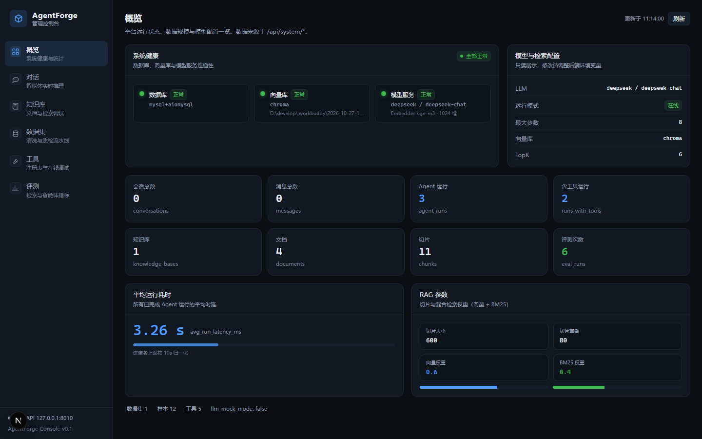
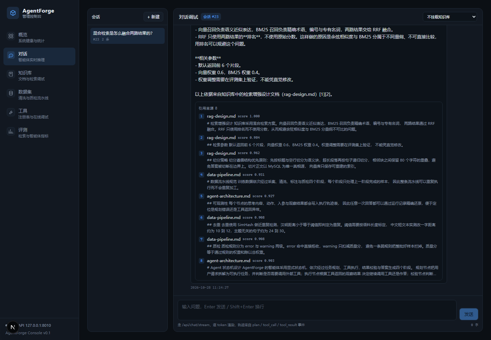
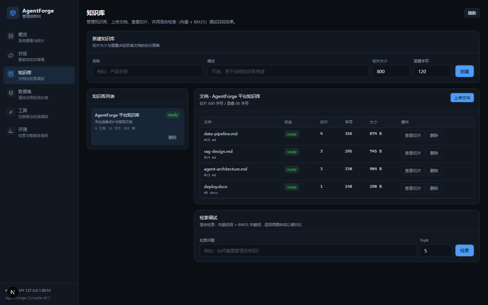
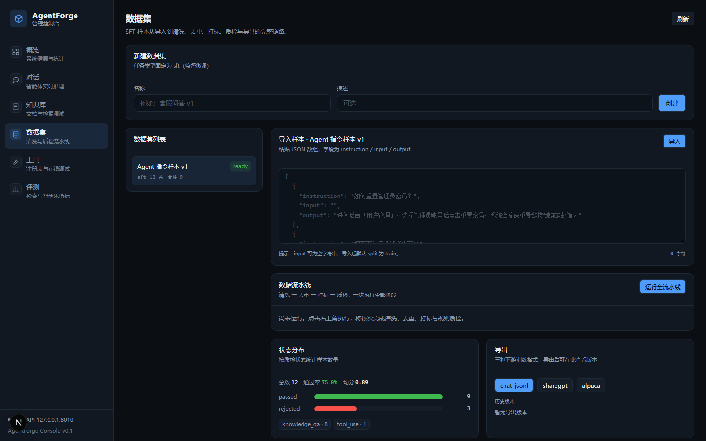
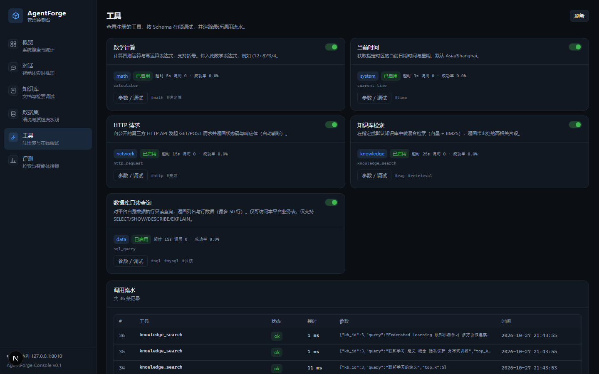
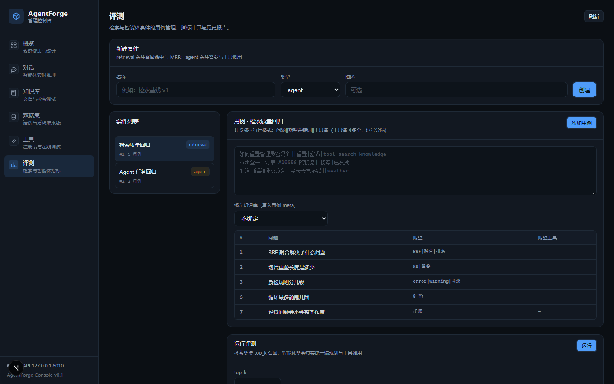

# AgentForge · 智能体研发平台

面向「AI 智能体（Agent）研发」岗位能力模型的全栈工程实现：**Agent 状态机 + 工具调用 + RAG 混合检索 + 训练数据流水线 + 评测体系 + 可观测性**。

后端 FastAPI + MySQL 8 + Chroma + BGE-M3 + DeepSeek，前端 Next.js + Tailwind，**100 条自动化测试全绿 / 覆盖率 75%**。

> **30 秒启动**：`cp .env.example .env`（填 DeepSeek API Key，留空也能跑）→ `docker compose up -d` → 打开 <http://localhost:3000>

## 三句话

1. **是什么**：一个能在本机跑起来的 AI 智能体平台，覆盖 Agent 编排 → 工具调用 → RAG 检索 → 训练数据质检 → 效果评测五条完整链路，前端带可视化控制台。
2. **亮点在哪**：Agent 循环是**手写状态机**（收敛条件、重复调用抑制、无证据停答都写在代码里，不靠模型自觉）；检索是**向量 + BM25 混合**并带引用溯源；每条回答都能通过运行记录还原「模型想了什么、调了什么、拿到了什么」。
3. **怎么验证**：不配 API Key 也能跑（自动降级为确定性 Mock），`pytest` 100 条用例可离线复现；所有「没做/没验证」的部分都写在文末「状态与限制」，而不是藏在代码里。

## 界面预览

| 概览（健康、规模、RAG 参数） | 对话（SSE 流式 + 引用溯源） |
|---|---|
|  |  |

| 知识库（入库与混合检索调试） | 数据集（清洗/去重/标注/质检） |
|---|---|
|  |  |

| 工具注册与在线试跑 | 评测（用例集与指标报告） |
|---|---|
|  |  |

> 对话页那张是真实运行结果：检索命中 8 个片段（带 score 与来源文档），
> 回答内容由 DeepSeek 基于这些片段生成，不是静态占位。

## 能力矩阵

| 岗位职责 | 实现 |
|---|---|
| Agent 核心架构、任务拆解、技术方案、原型迭代 | 手写显式状态机 `Plan → Act ⇄ Reflect → Answer`，可强制收敛、可回放轨迹 |
| 训练数据全流程 + 数据规范 + 质量指标 | 五阶段流水线（采集/清洗/标注/质检/导出），规则与指标全部落库，规范见 `docs/06-data-spec.md` |
| 工具调用、第三方 API 集成、自主决策 | 装饰器注册 + Schema 自动生成 + 超时/重试/幂等执行器 + 5 个内置工具 |
| Prompt 工程、RAG 知识库、场景化测试、问题排查 | 版本化 Prompt + 向量/BM25/RRF 混合检索 + 引用溯源 + retrieval/agent 双套件评测 |
| 规范技术文档 | `docs/` 六份文档 + OpenAPI 自动生成 + 一键灌数据的 `seed.py` |

## 快速开始

### 方式一：Docker（推荐，一条命令）

前置：[Docker Desktop](https://www.docker.com/products/docker-desktop/)（或 Docker Engine + compose 插件）。

```bash
git clone https://github.com/npc-p/agentforge.git
cd agentforge
cp .env.example .env          # 只需要改一个地方，见下
docker compose up -d          # 首次启动约 5~10 分钟（要下载 2.2 GB 向量模型）
```

打开 <http://localhost:3000> 即可。

**你只需要填一项**：`.env` 里的 `DEEPSEEK_API_KEY`

- 申请地址：<https://platform.deepseek.com/api_keys>
- **留空也能启动**：智能体会运行在「确定性 Mock」模式，所有页面都能点、全链路都能通，
  只是回答是固定模板而非模型生成；拿到 Key 后改这一行、`docker compose restart backend` 即可切换。

首次启动时容器会自动完成四件事，不需要手动操作：

1. 下载 BGE-M3 向量模型（约 2.2 GB，失败会自动降级为 `hashing`，服务照常可用）
2. 建表（18 张）
3. 灌演示数据（1 个知识库 / 3 篇文档 / 10 个切片 / 12 条样本 / 2 个评测套件，幂等，重启不会重复写）
4. 启动 API

查看进度与排查：

```bash
docker compose logs -f backend    # 看模型下载与初始化进度
docker compose ps                 # 三个服务都应是 healthy
curl -s http://localhost:8010/api/system/health | head -c 300
```

**国内网络注意**：Docker Hub 常拉不动基础镜像。在 Docker Desktop →
Settings → Docker Engine 的 JSON 里加一行（示例镜像站，可用性随时间变化）：

```json
{
  "registry-mirrors": ["https://docker.m.daocloud.io"]
}
```

### 方式二：本地开发（要改代码时用）

前置：Python **3.12**、MySQL 8、Node ≥ 20、[uv](https://docs.astral.sh/uv/)。

```bash
# 1. 建库
mysql -uroot -p -e "CREATE DATABASE agentforge DEFAULT CHARSET utf8mb4 COLLATE utf8mb4_unicode_ci;"

# 2. 后端依赖
cd backend
uv venv --python 3.12
uv pip install -p .venv/Scripts/python.exe -e .
uv pip install -p .venv/Scripts/python.exe -e ".[local-embed]"   # 可选：BGE-M3 本地向量化
cp .env.example .env        # 填 DATABASE_URL、DEEPSEEK_API_KEY

# 3. 向量模型（约 2.2 GB，想省事可跳过并在 .env 里设 EMBED_PROVIDER=hashing）
.venv/Scripts/python.exe scripts/fetch_model.py

# 4. 灌演示数据 + 启动
.venv/Scripts/python.exe scripts/seed.py
.venv/Scripts/python.exe -m uvicorn app.main:app --host 127.0.0.1 --port 8010 --reload

# 5. 前端（另开终端）
cd ../frontend && npm install && npm run dev     # http://localhost:3000
```

- 接口文档：<http://127.0.0.1:8010/docs>
- 健康检查：<http://127.0.0.1:8010/api/system/health>

### 常见问题

| 现象 | 原因与处理 |
|---|---|
| `docker compose up` 卡在拉取镜像 | Docker Hub 不通，按上面配 registry mirror |
| 首次启动很久没反应 | 在下 2.2 GB 模型，`docker compose logs -f backend` 能看到进度 |
| 端口被占用 | 改 `.env` 的 `BACKEND_PORT` / `FRONTEND_PORT` |
| 检索结果很差 | 模型下载失败降级到了 `hashing`，看启动日志确认 `EMBED_PROVIDER` |
| 想让镜像小一点 | `.env` 设 `WITH_LOCAL_EMBED=0` + `EMBED_PROVIDER=hashing`，镜像约省 1.5 GB |

## 目录结构

```
agentforge/
├── docker-compose.yml    一条命令启动（mysql + backend + frontend）
├── .env.example          环境变量模板：只需填 DEEPSEEK_API_KEY
├── deploy/mysql-init.sql 初始化只读账号（SQL 工具的权限边界）
├── backend/
│   ├── Dockerfile        后端镜像（torch 走 CPU 源，避免 3 GB CUDA）
│   ├── docker-entrypoint.sh  启动前下模型 + 灌演示数据，失败自动降级
│   ├── app/
│   │   ├── agent/        状态机、规划器、Prompt 模板
│   │   ├── api/routes/   42 个 HTTP 端点
│   │   ├── core/         日志/异常/响应信封/文本工具
│   │   ├── db/           异步引擎与 ORM 基类
│   │   ├── evaluation/   指标与评测执行器
│   │   ├── llm/          供应商抽象 + DeepSeek + Mock + 熔断网关
│   │   ├── models/       18 张表
│   │   ├── pipeline/     数据流水线五阶段
│   │   ├── rag/          解析/切分/向量化/向量库/BM25/检索
│   │   ├── schemas/      请求响应 DTO
│   │   ├── services/     会话与工具元数据服务
│   │   └── tools/        注册中心 + 执行器 + 内置工具
│   ├── scripts/          seed / 压测 / 模型下载 / 重切 / 嵌入对比
│   └── tests/            103 条用例（含真实 PDF/DOCX 夹具）
├── frontend/             Next.js 控制台（对话/知识库/数据集/工具/评测/概览）
├── docs/                 架构、接口、开发、优化、测试报告、数据规范
└── .github/workflows/    CI（MySQL 容器 + pytest + 前端构建）
```

## 技术选型

| 层 | 选择 | 关键理由 |
|---|---|---|
| Web | FastAPI | 异步原生、OpenAPI 自动生成、SSE 支持好 |
| 存储 | MySQL 8 + SQLAlchemy 2.0 | 对齐岗位的 MySQL 要求；类型化 ORM |
| 编排 | 手写状态机 | 终止条件与重复调用抑制必须由代码强制，框架黑盒会丢可观测性 |
| 模型 | DeepSeek（OpenAI 兼容）+ Mock 降级 | 兼容协议可平移；无 Key 仍可跑 |
| 向量 | Chroma + 可插拔 embedder（默认本地 BGE-M3 1024 维） | 零运维；1e5 量级下与 Milvus 无可感知差异（见架构文档决策依据） |
| 检索 | 向量 + BM25 + RRF | 语义与精确术语互补；RRF 规避量纲不可比 |

## 核心设计要点

1. **状态机而非自由循环**：最大轮次、重复调用抑制、连续失败熔断三类硬约束写在代码里，不依赖模型自觉；
2. **单一真相源**：切片正文存 MySQL，向量库只是可重建索引（`POST /knowledge/bases/{id}/rebuild`）；
3. **Schema 同源**：工具 JSON Schema 由函数签名自动生成，模型侧与执行侧绝不漂移；
4. **失败不放大**：参数错误不重试、工具失败转观察文本回灌模型、模型不可用降级 Mock、流式中断降级一次性返回；
5. **全链路可观测**：`trace_id` 贯穿日志与响应，每个 Agent 节点落 `agent_steps`，任意回答可回溯。

## 测试

```bash
cd agentforge/backend && .venv/Scripts/python.exe -m pytest tests -q
# 100 passed in 7.04s

# 带覆盖率（当前 75%，4218 条语句覆盖 3170 条）
.venv/Scripts/python.exe -m pytest tests -q --cov=app --cov-report=term
```

真实模型下的评测结果（`docs/05-test-report.md` 有完整报告）：

| 套件 | 指标 |
|---|---|
| 检索质量（5 用例，含 2 条零字面重叠） | hit_rate **1.0** / hit_rate_top1 0.8 / MRR **0.9** / p95 70 ms |
| Agent 任务（2 用例） | 2/2 通过，工具断言全部满足，均值 3818 ms |

## 可复用脚本

| 脚本 | 用途 |
|---|---|
| `scripts/fetch_model.py` | 下载本地向量模型（2.2 GB，支持断点续传与镜像切换） |
| `scripts/bench.py` | 并发压测任意接口（asyncio + httpx，零外部依赖） |
| `scripts/compare_embedder.py` | 对比两种嵌入的纯向量排序（排除 BM25 干扰） |
| `scripts/resplit.py` | 切分策略变更后重新入库（自动触发服务重建向量） |
| `scripts/compare_rerank.py` | 评估 Rerank 是否值得接入（当前结论：不接入，附实测数据） |

```bash
# 查知识库 id（不同环境的自增 id 不同，容器里通常是 1）
curl -s localhost:8010/api/knowledge/bases | head -c 200

# 首次部署：下模型
.venv/Scripts/python.exe scripts/fetch_model.py
# 压测检索接口：20 并发共 400 次
.venv/Scripts/python.exe scripts/bench.py -c 20 -n 400 -p /knowledge/search \
  --body '{"query":"混合检索如何融合","kb_id":1,"top_k":5}'   # kb_id 用下面这条查
```

## 文档

| 文档 | 内容 |
|---|---|
| [01-architecture.md](docs/01-architecture.md) | 分层架构、状态机、工具链路、RAG 链路、数据模型、可靠性设计 |
| [02-api.md](docs/02-api.md) | 接口契约、SSE 事件、错误码、典型调用序列 |
| [03-development.md](docs/03-development.md) | 环境搭建、分层纪律、四类扩展 SOP、调试手册、已踩过的坑 |
| [04-optimization.md](docs/04-optimization.md) | 已实施优化与收益、待优化排期、容量现状、成本控制 |
| [05-test-report.md](docs/05-test-report.md) | 测试方法、100 条用例明细、真实模型验证、11 个缺陷闭环、覆盖盲区 |
| [06-data-spec.md](docs/06-data-spec.md) | 样本字段规范、状态机、清洗/质检规则表、标注规范、导出格式、指标定义 |

## 状态与限制

当前为**可运行、可演示、可扩展**的工程样机，不是生产系统。使用前请阅读 `docs/05-test-report.md` §8：

- **定位为本地单机 demo**：服务仅监听 `127.0.0.1`，无用户认证与多租户隔离，请勿直接暴露到公网；
- 未做并发**写入**压测（只读路径已测：检索 20 并发 179 req/s、p95 234ms；写入受 Chroma 单进程写锁限制，未测）；
- PDF/DOCX 已用真实文件验证（含 3×3 表格与无文本层扫描件）；扫描件会被「解析后内容为空」明确拦截；
- **默认已用本地 BGE-M3**（1024 维，CPU 推理）：检索评测 hit_rate 1.0 / MRR 0.9。代价是单次检索 4 ms → 57 ms、内存占用 2.2 GB（启动时后台预热，首问实测 0.3 s）。需要极致轻量时可切回 `EMBED_PROVIDER=hashing`；
- Chroma 单进程写锁，不适合多副本部署；
- 文档入库为同步阻塞，大文件并发上传时请求耗时会拉长；
- **CI 已提供但未在 GitHub 上实跑**：`.github/workflows/backend-tests.yml` 配置了 MySQL 服务容器 +
  后端 pytest + 前端构建，触发方式暂为手动（`workflow_dispatch`），跑通后再打开 push/PR 触发。

**已做的安全边界**：`sql_query` 工具使用独立只读账号（`agentforge_ro`，仅本库 SELECT），并叠加由 ORM 元数据生成的表名白名单；无证据时（工具全部失败且无检索引用）走硬闸门返回固定话术，不调用模型生成。
